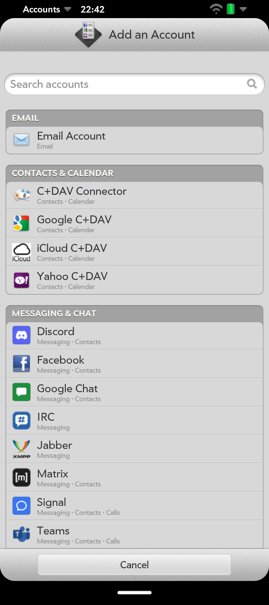
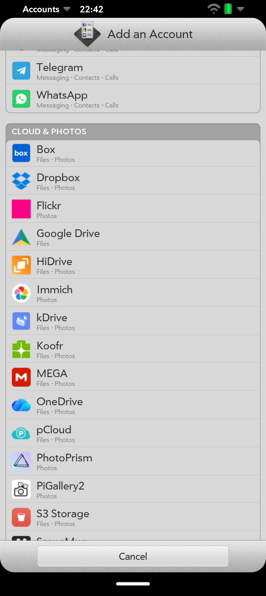
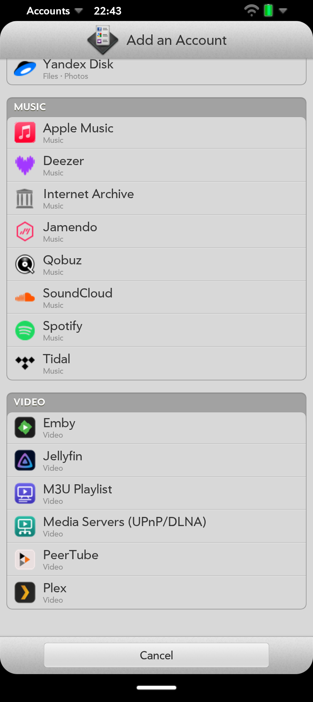

LuneOS en 2026
===============

## 3 ans déjà...

En [Février 2024](https://linuxfr.org/news/sortie-de-luneos-eiskaffee), je vous parlais de la sortie de LuneOS « Eiskaffe ». Dans cette version, les principales nouveautés concernaient le rafraîchissement de nos frameworks (notamment le passage de Qt5 à Qt6), la réutilisation de briques venant de webOS OSE (publié par LG), et l'accent mis sur les noyaux "mainline".

Depuis, les avancées ont été irrégulières, mais ont accéléré franchement cette année.

### Petits rappels

LuneOS est une distribution GNU/Linux pour téléphones mobiles et tablettes, héritière de feu webOS. 
Le projet est porté par l’équipe webOS-Ports, dont le but est de faire revivre webOS sur les matériels contemporains.

Le projet s’appuie sur Yocto, Halium et SHR. Il utilise OpenEmbedded comme environnement de compilation. Cette dernière version de LuneOS se base sur la version « Wrynose » de Yocto.

À l’exception des blobs utilisés pour faire tourner les pilotes Android, l’ensemble de la distribution est libre : chacun peut, s’il le veut, recompiler sa propre image chez lui.

## webOS OSE, une promesse non tenue

Depuis quelques années, LG fournissait un travail intéressant d'ouverture avec webOS OSE, avec une mise à jour du code assez régulière et des composants plutôt bien conçus. Cependant, depuis 2024, LG garde son code en interne et ne met plus à jour les dépôts publics. Ca a été une très mauvaise nouvelle pour notre petite équipe, qui n'a pas vraiment la bande passante pour maintenir soi-même tout ça correctement.

## un noyau "mainline" pour la HP Touchpad ?

En 2024, suite à une mise à jour de Yocto, nous nous sommes rendus compte qu'on ne pourrait plus continuer à maintenir le vieux noyau de la vénérable tablette HP Touchpad: utiliser un noyau linux 3.4 avec un systemd dernier cri était déjà un petit miracle, mais le grand écart devenait trop douloureux.
Nous avons donc regardé l'embryon de linux mainline existant droit dans les yeux, avec l'espoir de le faire tourner sur la Touchpad. Le point de départ: un noyau déjà capable de gérer le CPU, la mémoire et le stockage. L'écran s'allume, mais ça ne va pas beaucoup plus loin.

Pendant des mois, votre serviteur (un peu masochiste sur les bords) a tenté de comprendre les vieux hacks du linux 3.4 pour les transcrire en noeuds du Device Tree sur un linux récent. Pour l'aspect graphique, on a obtenu des résultats plutôt probants, même s'il restait pas mal d'artefacts visuels.

Cependant ce petit succès cachait une grande bataille perdue: le touchscreen refusait de se laisser dompter. Allez, voici quelques détails pour vous donner un aperçu de la bataille:
* il utilise un chipset CY8CTMA395, commandé exprès par HP pour cette tablette. Aucun autre matériel ne l'utilise. Il n'existe aucune documentation bien sûr, hormis le code plein de hacks du noyau HP.
* Cette puce communique sur un bus I2C pour sa configuration, mais également sur un bus UART pour ses données. Exit donc les drivers existants, qui font soit l'un soit l'autre.
* Comme ce bus UART requiert un débit de 4Mbps, il faut aussi faire marcher les transferts DMA en premier... et de ce côté il y a aussi beaucoup à faire.

Début 2025, j'abandonne: j'ai appris plein de choses (faire un device tree pour le noyau, débugger des transferts DMA, différences entre les bus I2C et UART...) mais je n'arrive pas à recoller les morceaux. 

## Période de doutes

Pendant l'année 2025, les choses avancent assez lentement: peu de temps libre, et une motivation en berne avec l'abandon de webOS OSE et l'échec sur la HP Touchpad. Nous somme alors environ 3 personnes à discuter sur IRC sur le projet, ça s'annonce mal pour la suite.

## Puis arrive 2026

Une de ces trois personne va revenir avec un nouveau jouet: il a pris un abonnement avec Claude, et il veut voir si on peut l'utiliser pour faire marcher la HP Touchpad avec noyau dernier cri. Il connait webOS et LuneOS par coeur et même si la programmation n'est pas son domaine d'expertise il se débrouille très bien face à des situations techniques complexes.

Dans les premiers jours, je le vois ainsi tomber dans les mêmes pièges que moi: flux UART instable, DMA mal configurée, device tree bancal. Puis il continue à faire itérer l'outil, le guide dans les différentes explorations, essai après essai. Au bout d'une semaine, la DMA se met à fonctionner correctement. Quelques jours plus tard, on a un pilote pour le touchscreen. 
Il va alors se pencher successivement sur le pilote wifi, bluetooth, le GPU, la pile USB, la gestion de la batterie... tous tombent les uns après les autres, itération après itération. Claude va compiler un noyau, le pousser sur la tablette avec un script initrd dédié à l'itération, puis redémarrer la tablette et extraire les logs. Ce qui m'avait épuisé pendant des mois, il le fait en quelques heures.

Vers la fin du mois de janvier 2026, on a donc une tablette HP Touchpad fonctionnelle sur [noyau linux 6.18](https://github.com/shr-distribution/linux/tree/tenderloin/6.18/upstream-patches). Deux mois, 40 dollars et quelques bébés phoques auront été le prix de cette impressionnante avancée.

## On accélère sur la gestion du matériel

Fort de ce succès, on (enfin, surtout celui qui utilise l'IA) va s'attaquer au gratte-ciel des bugs et problèmes qu'on n'aurait jamais pu résoudre dans cette vie. Je ne vais en lister que quelques-uns:

* Meilleures performances mémoire et eMMC
* Meilleure gestion de la batterie: on est maintenant à un niveau similaire à la "concurrence"
* Pile multimédia complètement remaniée, pour utiliser les profils PulseAudio et le composant audiod-pro de webOS OSE
* Gestion du fingerprint (via un driver Android)
* Gestion des caméras, en photo comme en vidéo
* Gestion de l'eSIM
* etc

Le portage vers de nouveaux smartphones est maintenant grandement simplifié, car LuneOS arrive à deviner la plupart des caractérisques dynamiquement. Une image Halium "GSI" (Generic System Image) de LuneOS peut maintenant être utilisée avec la plupart des smartphone Android. C'est ainsi qu'on a pu [porter le nombre de portages réussis à environ 25](https://webos-ports.org/#devices), un joli nombre comparé à avant !

Au bout de quelques mois, on commence à voir le bout du tunnel, et la plupart des problèmes connus sont corrigés. Il est temps de se recentrer sur l'aspect logiciel.

### De nouveaux serveurs pour nos builds

Cette année nous avons postulé à plusieurs offres de "bourses", qui se présentent sous la forme de serveurs pour la compilation de LuneOS. Et par chance, la réponse a été positive pour l'Université de l'Etat de l'Oregon (Oregon State University Open Source Lab) ! La mise en route du serveur est encore en cours, mais nous ainsi des machines plus confortables pour effectuer nos compilations, qui peuvent être très exigeantes. Merci à eux pour leur soutien !

### Un nouveau téléphone de test

Nous avons également été en contact avec l'entreprise Brax, qui commercialise des smartphones orientés vie privée et logiciels libres. Ils sont livrés avec LineageOS préinstallé et proposent quelques. 
Brax nous a envoyé gracieusement un exemplaire de leur Brax3, afin qu'on puisse porter et tester LuneOS dessus. Ce téléphone n'est pas parfait (noyau linux 5.5 maison, puce Mediatek moins bien documenté qu'un Quelcom), mais cela nous permet d'essayer LuneOS sur un smartphone assez récent.

## Renaissance d'un webOS disparu

Dans webOS, plusieurs aspects pourtant fondamentaux ont longtemps été négligés, faute de temps pour l'implémenter.

### Synergy

Synergy est un framework permettant de fusionner plusieurs "comptes" en ligne pour en exposer divers aspects de façon unifiées aux applications. On a vu ce type de fonctionnalité apparaître sur Android pour le stockage par exemple, et cela s'oppose à l'approche "par application" qui est malheureusement bien trop commune sur smartphone aujourd'hui.

Jusqu'à récemment sur LuneOS, on pouvait fusionner des comptes CalDAV, et des comptes de messagerie instantanée (ceux gérés par libpurple). Mais aujourd'hui on va beaucoup plus loin, car on peut gérer:
* des comptes de stockage, comme Dropbox, pCloud, kDrive, Mega et d'autres encore
* des comptes de streaming audio comme Spotify ou Qobuz
* des comptes de gallerie d'image comme PhotoPrism ou piGallery2

   

Tout cela est géré à travers un framework unifié, et des applications "Photos", "Musique" ou "Messages" deviennent alors complètement génériques. On a pu aussi, très facilement, implémenter une fonctionnalité de sauvegarde qui va stocker/restaurer tous ces comptes avec un fichier chiffré.

### Le look & feel

webOS, c'est aussi une identité visuelle, et une ergonomie souvent bien pensée. Ainsi on a pu se rapprocher un peu plus des visuels d'origine, tout en gardant à l'esprit les contraintes modernes (SVG pour du HiDPI, shaders pour économiser le CPU, plus de personnalisation pour s'adapter à chaque cible matérielle...).

Pour les plus nostalgiques, nous avons aussi changé le clavier virtuel par défaut pour nous rapprocher du clavier du Palm Pre:

### Site web rafraîchi

Nous avons également retravaillé notre vieux site web, qui est maintenant accessible sur [luneos.org](https://luneos.org/). On y a rajouté de la [documentation technique](https://webos-ports.org/architecture/), des pointeurs vers les communautés LuneOS et webOS...

## L'heure du bilan

### Contributions upstream

Autant que possible, si on voit qu'une de nos corrections ou améliorations pourrait intéresser le projet parent, on va essayer de leur proposer ça. Nous avons déjà plusieurs corrections ou améliorations dans libpurple qui ont pu être remontées, de même pour des projets comme Mer ou Waydroid. Nous avons testé ces changements en condition réelle, donc une première passe a déjà été faite. 

### La baleine sous le caillou

Le LuneOS de 2026 est maintenant un projet où l'IA a changé beaucoup de choses, en bien comme en mal. On a pu corriger énormément de problèmes et rajouter beaucoup de fonctionnalités, par contre cela s'est fait au prix d'une complexification du code. Mais le code de LuneOS était déjà vaste avant 2026, et les contributions étant faites par quelqu'un connaissant très bien le projet, les changements apportés s'intègre encore assez bien dans l'existant.

Notons aussi qu'on ne lance pas l'IA sur un problème à l'aveugle, on essaie de capitaliser sur ce qui a été déjà résolu. Ainsi on a mis en place un [dépôt MCP](https://github.com/webOS-ports/luneos-porting-mcp) pour que tout un chacun en profite, et ne gaspille pas des tokens pour rien. En soi ce dépôt peut être aussi intéressant pour un développeur qui souhaite en savoir plus sur le déroulement d'un portage LuneOS.

L'utilisation de l'IA peut rebuter des contributeurs comme des utilisateurs, par exemple pour des raisons éthiques et environnementales. Personnellement, fin 2025 je pensais que LuneOS était terminé, nous n'étions plus assez nombreux et avec le retrait de LG il fallait maintenir bien plus de composants qu'avant. Donc si vous voulez installer ce que LuneOS aurait été en 2026 sans l'IA, c'est simple: il suffit d'installer la version de 2025. L'arrivée de l'IA a permis de redonner une chance au projet, même si on doit encore voir sur le moyen terme ce que ça va donner.

## Ce qui nous attends ensuite

### Montée en puissance des machines de build

On devra décider comment exploiter au mieux ces belles machines qu'on nous prête pour effectuer nos grosses compilations de LuneOS. Je ne m'inquiète pas trop sur ce point, c'est plus un cadeau qu'un problème :)

### Tester tout ça en profondeur

Après ces nombreux nouveaux ajouts et changements, il faudra mettre l'accent sur la stabilité et les tests manuels. On vérifie régulièrement sur l'appareil ce que donne une modification, mais on trouve toujours des scénarios d'usage qu'on n'a pas prévu.

### Mise à jour du système "en live"

LuneOS est basé sur un système de "paquets", tout à fait comme une distribution Linux classique. Il est donc naturel de vouloir profiter de cela pour mettre à jour le système. Avec Yocto c'est quasiment gratuit, car le versioning des paquets est déjà complètement intégré au systeme de build. Par contre, de notre côté, il nous faudra établir des règles strictes pour la sortie de nouveaux paquets, et trouver la bonne méthode pour appliquer ces mises à jour.

